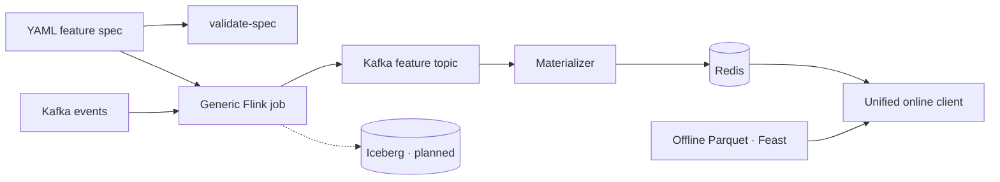

  

  

  
  
  
  

---

## 📓 My daily log

Since April 13, 2026 I write a Today I Learned entry. It's my notebook: what I learned, what I built, what broke. All of it is public, including the mistakes. The three badges below are counted straight from the log by a small script, so I can't round them up.

  
  
  

My routine is simple. I pick a topic from the roadmap, build something small so I know I really got it, and write the entry. I also write down what I skipped on purpose and what is still open.

**[→ Read the full log](./til/README.md)**

---

## 🔥 Activity

  

  
  

  

  <picture>
    <source media="(prefers-color-scheme: dark)" srcset="https://raw.githubusercontent.com/oster-dev/oster-dev/output/github-snake-dark.svg" />
    <source media="(prefers-color-scheme: light)" srcset="https://raw.githubusercontent.com/oster-dev/oster-dev/output/github-snake.svg" />
    
  </picture>

---

## 🗺️ The roadmap

Eight months, April to November 2026. I planned it at the start and track it here. Every month ends with a milestone and a short review. The plan changed a little along the way, and the reviews say where.

| Month | Focus | Milestone | Status |
| :-- | :-- | :-- | :-- |
| 1 · Apr | Python, SQL, Git, Linux | Foundation, two pipeline projects | ✅ [Review](./monthly-updates/month-01.md) |
| 2 · May | AWS CLF-C02, Docker | First AWS certification | ✅ [Review](./monthly-updates/month-02.md) |
| 3 · Jun | AWS DEA-C01, Spark, Scala literacy | Data engineering foundation | ✅ [Review](./monthly-updates/month-03.md) |
| 4 · Jul | Kafka, Airflow, system design | Streaming fundamentals | ✅ [Review](./monthly-updates/month-04.md) |
| 5 · Aug | AWS SAA-C03, FeatureForge launch | FeatureForge v0.1.0 | ✅ [Review](./monthly-updates/month-05.md) |
| 6 · Sep | MLflow, Metaflow, open source | Lifecycle lab, merged MLflow PR | ✅ [Review](./monthly-updates/month-06.md) |
| 7 · Oct | FeatureForge streaming | Generic spec-driven Flink job, recovery tests | ✅ |
| 8 · Nov | FeatureForge spec platform, applications | Plan: Iceberg datasets, Cassandra, serving numbers | 🔄 In progress |

---

## 🚀 FeatureForge

**[FeatureForge](https://github.com/oster-dev/featureforge)** is my main project. You describe a feature in a YAML file. The platform computes it from a Kafka stream with Flink, writes it to Redis and tests it. It runs on my laptop with Docker Compose and synthetic data, so it's a local build and not a production system.

Here is what works today, and which test proves it:

| What works | Proof |
| :-- | :-- |
| One generic Flink job runs features from YAML specs, no code per feature | [`STATUS.md`](https://github.com/oster-dev/featureforge/blob/main/STATUS.md) |
| A feature keyed by content instead of user, from a spec alone, matching hand-calculated windows | `test_generic_job_content_play_count.py` |
| Event time, late events, dedupe, replays, conflicting events | `tests/integration/` |
| Savepoint resume and recovery after a TaskManager crash | `test_generic_job_recovery.py`, `test_generic_job_checkpoint_recovery.py` |
| Dedupe state expires after its TTL, shown with a short TTL | integration test, see STATUS |
| Redis writes that stay correct under concurrency | `test_streaming_redis_online_store*.py` |
| `featureforge validate-spec` with clear exit codes | `test_cli_validate_spec.py` |
| 476 unit tests and 44 integration tests, run in CI | `.github/workflows/ci.yml` |

**What it can't do yet:** it only runs locally on synthetic data, I have no latency or throughput numbers, and the Kafka sinks are at-least-once, so I don't claim exactly-once.

### 🧭 Where it stands

The percentages are my own estimate.

| What | Progress | Note |
| :-- | :-- | :-- |
| Streaming core (Kafka, Flink, Redis) |  | Done |
| Declarative specs and generic job |  | Stores and Spark backfill still open |
| Recovery |  | TaskManager and savepoint done, JobManager open |
| Iceberg training datasets |  | Next |
| Cassandra as a second online store |  | Planned |
| Serving service with p99 latency |  | Planned |

---

## 🛠️ Tools I use

---

## 📁 Other projects

| Project | What it is |
| :-- | :-- |
| **[MLflow Model Lifecycle Lab](https://github.com/oster-dev/mlflow-model-lifecycle-lab)** | MLflow tracking and registry, Metaflow, a tested quality gate, CI |
| **[Kafka + Airflow + PostgreSQL](https://github.com/oster-dev/projects/tree/main/event-stream-pipeline)** | An event-stream pipeline with orchestration |
| **[PySpark Retail ETL](https://github.com/oster-dev/projects/tree/main/Retaildata%20PYSparkETL)** | A retail data ETL with PySpark |
| **[Jikan Feature Pipeline](https://github.com/oster-dev/projects/tree/main/jikan-feature-pipeline-dockerized)** | My first public project: API data in, validated features out |

---

## 🏅 Certifications and open source

| | Status |
| :-- | :-- |
| AWS Cloud Practitioner · CLF-C02 | ✅ [Passed](https://www.credly.com/badges/2c2b32e6-4bc9-4e60-ad56-3cf7bc2775bd/public_url) |
| AWS Data Engineer Associate · DEA-C01 | ✅ [Passed](https://www.credly.com/badges/76633228-8b19-4fb6-81bd-ebea0e96f087/public_url) |
| AWS Solutions Architect Associate · SAA-C03 | ✅ [Passed](https://www.credly.com/badges/323635b9-4840-4a90-8900-a2a86b8082c1/public_url) |
| AWS ML Engineer Associate · MLA-C02 | ⏸️ I didn't pass the beta exam. I'll retake it when the official exam is out |
| MLflow documentation fix | ✅ Merged: [#26287](https://github.com/mlflow/mlflow/pull/26287) |

---

## 👋 About me

I'm Nico, 24, from Cologne. I started programming in March 2026 with a Python bootcamp and decided to aim at ML platform and feature infrastructure work. Since then I work on it every day: learn, build, write it down.

I like systems where the hard part is getting things right, like late events, duplicates and what happens after a crash. I like proving that with a test. I'm looking for a role where I can do this for real.

📍 Cologne, Germany · 🌍 Open to remote work worldwide
📬 [ostermann.dev@gmail.com](mailto:ostermann.dev@gmail.com) · 💼 [LinkedIn](https://www.linkedin.com/in/nico-ostermann-606a6b402)

  

