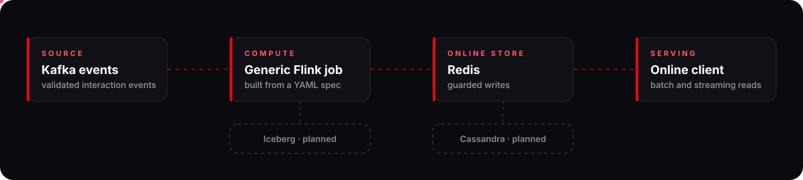
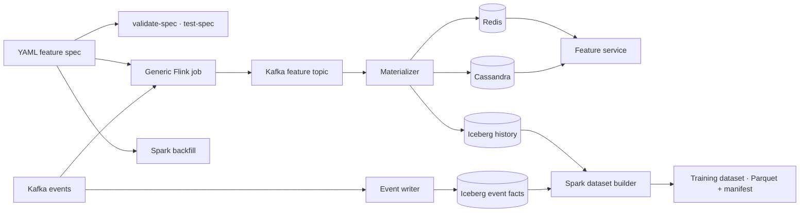

  

  <b>I write down what I learn, every day. Right now I'm building a feature platform on Flink, Kafka, Redis and Cassandra.</b> 
  Open to work in feature infrastructure and ML platforms.

  
  
  
  

---

## My daily log

Since April 13, 2026 I write a Today I Learned entry. It's my notebook: what I learned, what I built, what broke. 

**[→ Read the full log](./til/README.md)**

---

## Activity

  

  <picture>
    <source media="(prefers-color-scheme: dark)" srcset="https://raw.githubusercontent.com/oster-dev/oster-dev/output/github-snake-dark.svg" />
    <source media="(prefers-color-scheme: light)" srcset="https://raw.githubusercontent.com/oster-dev/oster-dev/output/github-snake.svg" />
    
  </picture>

---

## The roadmap

Eight months, April to November 2026. I planned it at the start and track it here. Every month ends with a milestone and a short review. The plan changed a little along the way, and the reviews say where.

| Month | Focus | Milestone | Status |
| :-- | :-- | :-- | :-- |
| 1 · Apr | Python, SQL, Git, Linux | Foundation, two pipeline projects | ✅ [Review](./monthly-updates/month-01.md) |
| 2 · May | AWS CLF-C02, Docker | First AWS certification | ✅ [Review](./monthly-updates/month-02.md) |
| 3 · Jun | AWS DEA-C01, Spark, Scala literacy | Data engineering foundation | ✅ [Review](./monthly-updates/month-03.md) |
| 4 · Jul | Kafka, Airflow, system design | Streaming fundamentals | ✅ [Review](./monthly-updates/month-04.md) |
| 5 · Aug | AWS SAA-C03, FeatureForge launch | FeatureForge v0.1.0 | ✅ [Review](./monthly-updates/month-05.md) |
| 6 · Sep | MLflow, Metaflow, open source | Lifecycle lab, merged MLflow PR | ✅ [Review](./monthly-updates/month-06.md) |
| 7 · Oct | FeatureForge streaming | Generic spec-driven Flink job, recovery tests | ✅ |
| 8 · Nov | FeatureForge spec platform, applications | Iceberg datasets, Cassandra, a serving service with measured latency | 🔄 In progress |

**Next:** more spec operators and composite keys, operations (alerts, recovery drills, a soak run), practitioner tooling and a v1.0 release. The order and the proof for each step are in [`STATUS.md`](https://github.com/oster-dev/featureforge/blob/main/STATUS.md).

---

## FeatureForge

**[FeatureForge](https://github.com/oster-dev/featureforge)** is my main project. You describe a feature in a YAML file. The platform computes it from a Kafka stream with Flink, writes it to Redis or Cassandra, serves it through a service that returns a status for every value, and builds point-in-time training data from an Iceberg history. It runs on my laptop with Docker Compose and synthetic data, so it's a local build and not a production system.

  

  
  
  
  

The latency numbers are local measurements: one laptop, one service process, Redis and Cassandra in Docker. They are not production numbers.

Here is what works today, and which test or document proves it:

| What works | Proof |
| :-- | :-- |
| One generic Flink job runs features from YAML specs, no code per feature | [`STATUS.md`](https://github.com/oster-dev/featureforge/blob/main/STATUS.md) |
| A feature keyed by content instead of user, from a spec alone, matching hand-calculated windows | `test_generic_job_content_play_count.py` |
| Event time, late events, dedupe, replays, conflicting events | `tests/integration/` |
| Savepoint resume and recovery after a TaskManager crash | `test_generic_job_recovery.py`, `test_generic_job_checkpoint_recovery.py` |
| Redis writes that stay correct under concurrency | `test_streaming_redis_online_store*.py` |
| Redis and Cassandra behind one store contract, and the same spec runs on both by changing one setting | `test_online_store_contract.py`, `test_cassandra_end_to_end.py` |
| A serving service with a status per value (`ok`, `missing`, `stale`, `backend_error`), never a silent zero, that survives a stopped or slow Redis | `test_feature_service_redis.py`, `test_feature_service_faults.py` |
| Training datasets in two explicit modes (event time and published as of) from an Iceberg history, with a pinned snapshot | `test_training_dataset_published.py`, `test_event_writer_kafka.py` |
| Measured latency and the saturation point on one laptop | [`docs/benchmarks.md`](https://github.com/oster-dev/featureforge/blob/main/docs/benchmarks.md) |
| `validate-spec` and `test-spec` with clear exit codes, no Docker needed | `test_cli_validate_spec.py`, `test_cli_test_spec.py` |

**What it can't do yet:** it runs locally on synthetic data, so I have no production numbers. Flink and Spark support count and ratio features only, JobManager failure is not proven, there are no alert rules or soak run yet, and the Kafka sinks are at-least-once, so I don't claim exactly-once.

<b>Full architecture diagram</b>

 

### Where it stands

The percentages are my own estimate.

| What | Progress | Note |
| :-- | :-- | :-- |
| Streaming core (Kafka, Flink, Redis) |  | Done |
| Declarative specs and generic job |  | Count and ratio only, more operators next |
| Recovery |  | TaskManager and savepoint done, JobManager open |
| Iceberg history and training datasets |  | Both modes done, operators beyond count open |
| Cassandra as a second online store |  | Behind one contract, a Compose service is open |
| Serving service with p99 latency |  | Measured on one laptop, one process |
| Operations |  | Metrics and a dashboard, no alerts or soak run |
| Catalog, embeddings, ML workflow |  | Planned |

---

## Tools I use

---

## Other projects

| Project | What it is |
| :-- | :-- |
| **[MLflow Model Lifecycle Lab](https://github.com/oster-dev/mlflow-model-lifecycle-lab)** | MLflow tracking and registry, Metaflow, a tested quality gate, CI |
| **[Kafka + Airflow + PostgreSQL](https://github.com/oster-dev/projects/tree/main/event-stream-pipeline)** | An event-stream pipeline with orchestration |
| **[PySpark Retail ETL](https://github.com/oster-dev/projects/tree/main/Retaildata%20PYSparkETL)** | A retail data ETL with PySpark |
| **[Jikan Feature Pipeline](https://github.com/oster-dev/projects/tree/main/jikan-feature-pipeline-dockerized)** | My first public project: API data in, validated features out |

---

## Certifications and open source

| | Status |
| :-- | :-- |
| AWS Cloud Practitioner · CLF-C02 | ✅ [Passed](https://www.credly.com/badges/2c2b32e6-4bc9-4e60-ad56-3cf7bc2775bd/public_url) |
| AWS Data Engineer Associate · DEA-C01 | ✅ [Passed](https://www.credly.com/badges/76633228-8b19-4fb6-81bd-ebea0e96f087/public_url) |
| AWS Solutions Architect Associate · SAA-C03 | ✅ [Passed](https://www.credly.com/badges/323635b9-4840-4a90-8900-a2a86b8082c1/public_url) |
| AWS ML Engineer Associate · MLA-C02 | ⏸️ I didn't pass the beta exam. I'll retake it when the official exam is out |
| MLflow documentation fix | ✅ Merged: [#26287](https://github.com/mlflow/mlflow/pull/26287) |

---

## About me

I'm Nico, 24, from Cologne. I started programming in March 2026 with a Python bootcamp and decided to aim at ML platform and feature infrastructure work. Since then I work on it every day: learn, build, write it down.

I like systems where the hard part is getting things right, like late events, duplicates and what happens after a crash. I like proving that with a test. I'm looking for a role where I can do this for real.

📍 Cologne, Germany · 🌍 Open to remote work worldwide
📬 [ostermann.dev@gmail.com](mailto:ostermann.dev@gmail.com) · 💼 [LinkedIn](https://www.linkedin.com/in/nico-ostermann-606a6b402)

  

